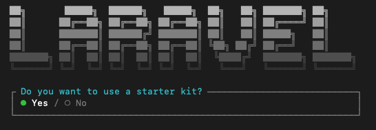
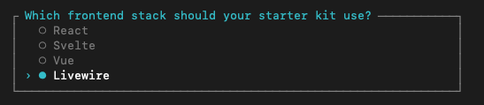
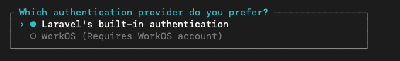
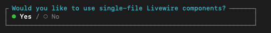
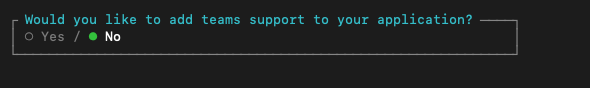
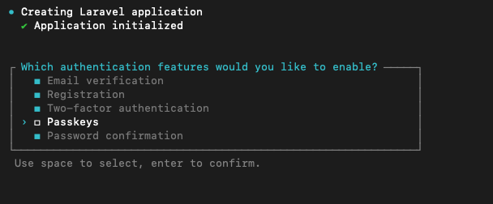
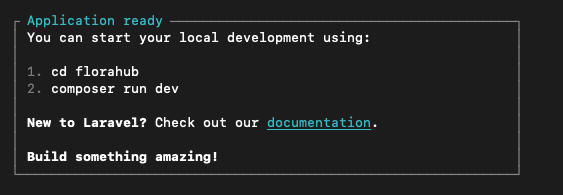

# Guia 01 — Instalação e Configuração Inicial

Neste primeiro passo vamos criar o projeto **FloraHub** utilizando **Laravel 13** e o starter kit oficial **Livewire**.

O projeto será criado através do **Laravel Installer**, que permite selecionar interativamente o starter kit, autenticação e restantes opções iniciais da aplicação.

---

**Documentação oficial:**

- Laravel: https://laravel.com/docs/13.x
- Instalação: https://laravel.com/docs/13.x/installation
- Starter Kits: https://laravel.com/docs/13.x/starter-kits
- Livewire: https://livewire.laravel.com/docs/4.x

---

**Índice**

<!-- TOC -->
* [Guia 01 — Instalação e Configuração Inicial](#guia-01--instalação-e-configuração-inicial)
  * [1. Verificar os pré-requisitos](#1-verificar-os-pré-requisitos)
  * [2. Instalar o Laravel Installer](#2-instalar-o-laravel-installer)
    * [2.1 Problemas com o comando `laravel`](#21-problemas-com-o-comando-laravel)
      * [macOS / Linux](#macos--linux)
      * [Windows](#windows)
  * [3. Criar o projeto](#3-criar-o-projeto)
    * [3.1. Selecionar um Starter Kit](#31-selecionar-um-starter-kit)
    * [3.2. Escolher a tecnologia frontend](#32-escolher-a-tecnologia-frontend)
    * [3.3 Escolher o sistema de autenticação](#33-escolher-o-sistema-de-autenticação)
    * [3.4. Componentes Livewire](#34-componentes-livewire)
    * [3.5. Teams](#35-teams)
    * [3.6 Funcionalidades de autenticação](#36-funcionalidades-de-autenticação)
    * [3.7. Aplicação criada](#37-aplicação-criada)
  * [4. Instalar e compilar os recursos frontend](#4-instalar-e-compilar-os-recursos-frontend)
  * [5. Executar a aplicação](#5-executar-a-aplicação)
  * [6. Teste e Verificação final](#6-teste-e-verificação-final)
    * [Estrutura de pastas criadas](#estrutura-de-pastas-criadas)
<!-- TOC -->

---

## 1. Verificar os pré-requisitos

Antes de começar, confirmar que estão instalados:

```bash
php -v
composer -V
node -v
npm -v
```

O Laravel 13 requer **PHP 8.3 ou superior**.

---

## 2. Instalar o Laravel Installer

O Laravel Installer é uma ferramenta de linha de comandos que permite criar novos projetos Laravel.

Se ainda não estiver instalado:

```bash
composer global require laravel/installer
```

Se já estiver instalado, deve ser atualizado:

```bash
composer global update laravel/installer
```

Confirmar a versão:

```bash
laravel --version
```

Neste projeto estamos a utilizar o Laravel Installer **5.x**.

> Uma versão antiga do Laravel Installer pode apresentar opções de instalação diferentes das utilizadas neste guião.

---

### 2.1 Problemas com o comando `laravel`

Se ao executar:

```bash
laravel --version
```

for apresentada uma mensagem semelhante a:

```text
command not found: laravel
```

o diretório dos executáveis globais do Composer poderá não estar definido na variável de ambiente `PATH`.

Descobrir primeiro o diretório utilizado pelo Composer:

```bash
composer global config bin-dir --absolute
```

#### macOS / Linux

O resultado será semelhante a:

```text
/Users/utilizador/.composer/vendor/bin
```

ou poderá utilizar outro diretório, dependendo da instalação do Composer.

Adicionar **o caminho devolvido pelo comando anterior** ao `PATH`.

Por exemplo, utilizando Zsh:

```bash
echo 'export PATH="$PATH:$HOME/.composer/vendor/bin"' >> ~/.zshrc
source ~/.zshrc
```

> Não copies este caminho automaticamente. Utiliza o caminho apresentado por `composer global config bin-dir --absolute`.

Voltar a testar:

```bash
laravel --version
```

#### Windows

Executar:

```powershell
composer global config bin-dir --absolute
```

Copiar o caminho apresentado e adicioná-lo à variável de ambiente **Path** do Windows.

Depois de alterar o `Path`, fechar e voltar a abrir o terminal.

Confirmar:

```powershell
laravel --version
```

---

## 3. Criar o projeto

Posicionar o terminal na pasta onde será criado o projeto e executar:

```bash
laravel new florahub
```

O Laravel Installer inicia um assistente interativo.

---

### 3.1. Selecionar um Starter Kit

Selecionar:

```text
Do you want to use a starter kit?
→ Yes
```



Os starter kits fornecem uma estrutura inicial para a aplicação, incluindo a implementação do sistema de autenticação.

---

### 3.2. Escolher a tecnologia frontend

Selecionar:

```text
Which frontend stack should your starter kit use?
→ Livewire
```

 

O Laravel disponibiliza atualmente starter kits para:

- React
- Svelte
- Vue
- Livewire

Neste projeto utilizaremos **Livewire**, permitindo criar interfaces reativas mantendo PHP, Blade e Laravel como tecnologias principais.

---

### 3.3 Escolher o sistema de autenticação

Selecionar:

```text
Which authentication provider do you prefer?
→ Laravel's built-in authentication
```



Não utilizaremos WorkOS.

A autenticação fornecida pelo starter kit Laravel utiliza **Laravel Fortify**.

---

### 3.4. Componentes Livewire

Selecionar:

```text
Would you like to use single-file Livewire components?
→ Yes
```



Utilizaremos os **Single-File Components** do Livewire 4.

Nestes componentes podemos manter a lógica PHP e o template Blade associados no mesmo ficheiro.

---

### 3.5. Teams

Selecionar:

```text
Would you like to add teams support to your application?
→ No
```



A aplicação FloraHub não necessita de equipas ou organizações de utilizadores.

---

### 3.6 Funcionalidades de autenticação

Selecionar:

```text
[x] Email verification
[x] Registration
[x] Two-factor authentication
[ ] Passkeys
[x] Password confirmation
```



Serão utilizadas as seguintes funcionalidades:

- **Email verification** — verificação do endereço de email;
- **Registration** — registo de novos utilizadores;
- **Two-factor authentication** — autenticação de dois fatores;
- **Password confirmation** — confirmação da password antes de operações sensíveis.

Não utilizaremos **Passkeys** neste projeto.

---

### 3.7. Aplicação criada

No final deverá ser apresentada a mensagem:



Entrar na pasta do projeto:

```bash
cd florahub
```

---

## 4. Instalar e compilar os recursos frontend

Instalar as dependências JavaScript:

```bash
npm install
```

Executar o seed do utilizador existente.

```bash
php artisan migrate:fresh --seed
```

As credênciais criadas por defeito são:

```text
email    => test@example.com
password => password
```


---

## 5. Executar a aplicação

O projeto inclui um script Composer que inicia os serviços necessários ao ambiente de desenvolvimento:

```bash
composer run dev
```

A aplicação ficará normalmente disponível em:

```text
http://localhost:8000
```

O comando inicia os processos de desenvolvimento definidos pelo projeto, incluindo o servidor Laravel e o Vite.

---

## 6. Teste e Verificação final

Abrir a aplicação no browser. Deverão estar disponíveis as funcionalidades iniciais do starter kit, nomeadamente:

- página inicial;
- registo;
- login;
- recuperação de password;
- verificação de email;
- autenticação de dois fatores;
- área autenticada.

A partir deste ponto temos a aplicação base sobre a qual será desenvolvido o projeto **FloraHub**.

### Estrutura de pastas criadas

Observar particularmente:

```text
app/
config/
database/
resources/
routes/
```

No Starter Kit Livewire, observar também:

```text
resources/views/
├── components/
├── flux/
├── layouts/
├── pages/
└── partials/
```

O Starter Kit fornece uma aplicação funcional. Ao longo do projeto iremos substituir e adaptar esta interface à aplicação FloraHub.

---
