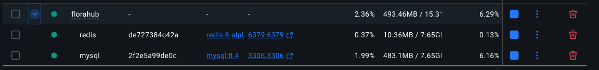
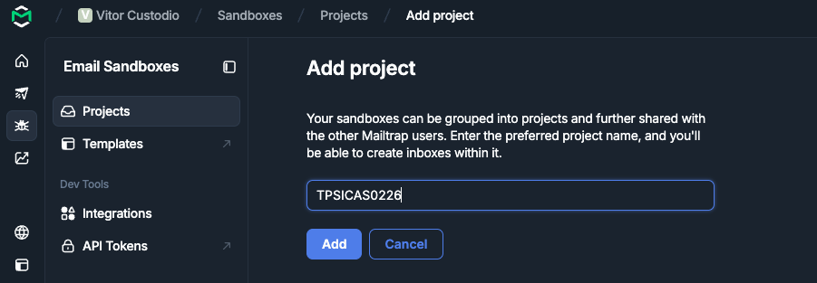
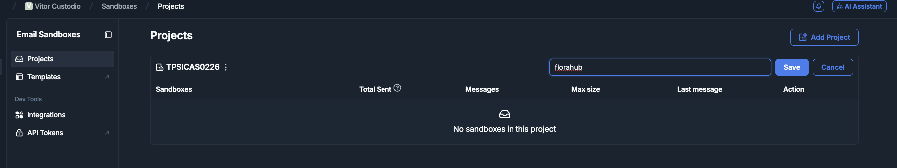
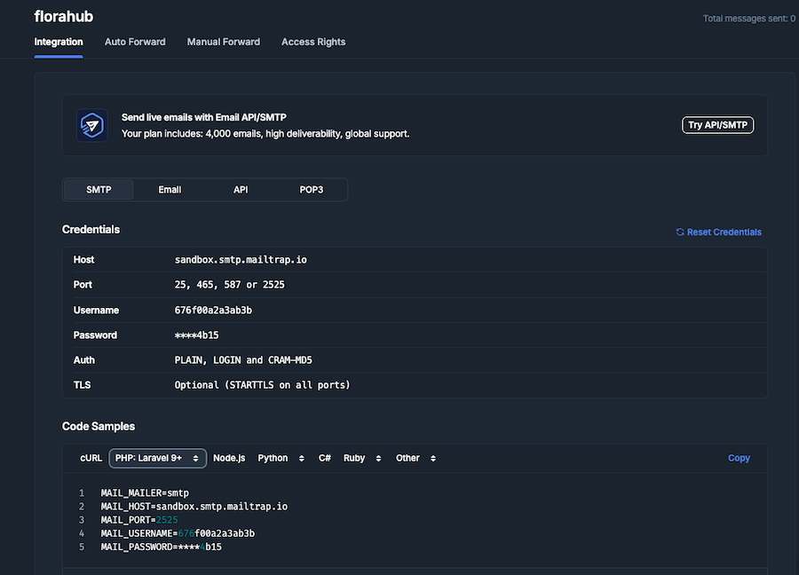
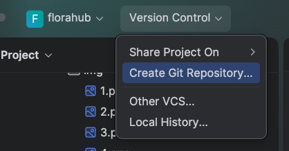
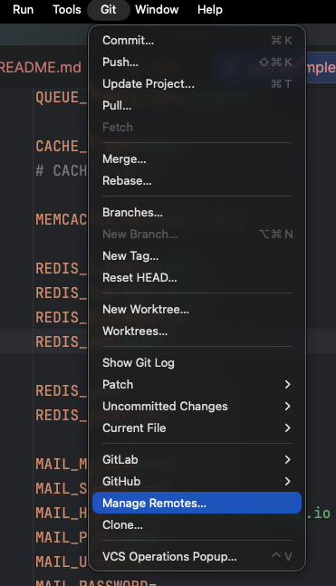
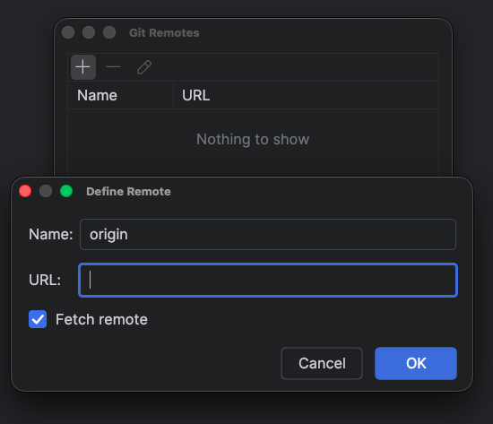
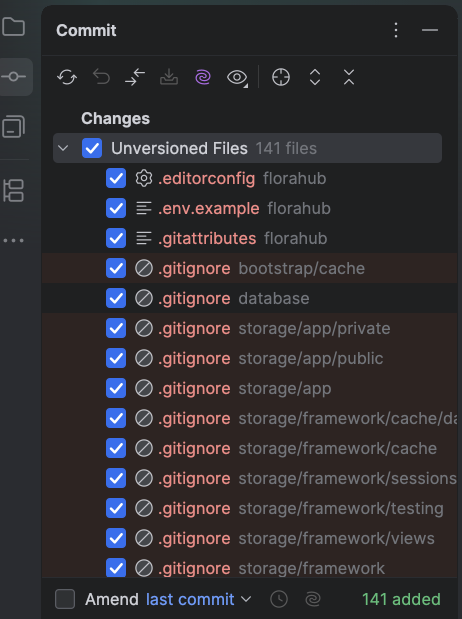

# Guia 02 —  Configuração de serviços 

Neste passo vamos preparar os serviços externos utilizados pela aplicação FloraHub.

No final teremos:

```text
FloraHub
│
├── Laravel 13 / Livewire 4       → execução local
│
├── MySQL                         → Docker
├── Redis                         → Docker
├── Mailtrap                      → serviço externo
│
└── GitLab                        → repositório Git
```

---

## 1. Serviços com Docker

Não vamos instalar MySQL e Redis diretamente no sistema operativo. Estes serviços serão executados através de _containers_ Docker.

A aplicação Laravel continuará a executar diretamente no computador.

### 1.1. Verificar Docker

Confirmar que o Docker está instalado e em execução:

```bash
docker --version
docker compose version
```

---

### 1.2. Criar `compose.yaml`

Na raiz do projeto criar:

```text
compose.yaml
```

com:

```yaml
services:

  mysql:
    image: mysql:8.4
    container_name: florahub-mysql
    restart: unless-stopped
    environment:
      MYSQL_DATABASE: florahub
      MYSQL_USER: florahub
      MYSQL_PASSWORD: florahub
      MYSQL_ROOT_PASSWORD: root
    ports:
      - "3306:3306"
    volumes:
      - florahub-mysql-data:/var/lib/mysql
    healthcheck:
      test: ["CMD", "mysqladmin", "ping", "-h", "localhost"]
      interval: 5s
      timeout: 5s
      retries: 10

  redis:
    image: redis:8-alpine
    container_name: florahub-redis
    restart: unless-stopped
    ports:
      - "6379:6379"
    volumes:
      - florahub-redis-data:/data
    healthcheck:
      test: ["CMD", "redis-cli", "ping"]
      interval: 5s
      timeout: 5s
      retries: 10

volumes:
  florahub-mysql-data:
  florahub-redis-data:
```

Neste projeto os containers disponibilizam os serviços através de:

```text
MySQL  → localhost:3306
Redis  → localhost:6379
```

Os volumes permitem conservar os dados mesmo depois de os containers serem desligados.

---

### 1.3. Iniciar os serviços

Em primeiro lugar abrir o Docker Desktop e parar todos os serviços. Depois através do terminal
executar:

```bash
docker compose up -d
```

Verificar:

```bash
docker compose ps
```

Deverão existir dois containers:

```text
florahub-mysql
florahub-redis
```

Também pode ver através da aplicação Docker Desktop:



---

### 1.4. Parar os serviços e outros comandos

```bash
docker compose down
```

Este comando remove os containers, mas mantém os dados guardados nos volumes.

Para voltar a iniciar:

```bash
docker compose up -d
```

> Não utilizar `docker compose down -v` sem perceber as consequências. A opção `-v` remove também os volumes e, consequentemente, os dados da base de dados.

---

## 2. Configurar MySQL

Editar o ficheiro `.env`:

```env
DB_CONNECTION=mysql
DB_HOST=127.0.0.1
DB_PORT=3306
DB_DATABASE=florahub
DB_USERNAME=florahub
DB_PASSWORD=florahub
```

### 2.1. Executar as migrations

```bash
php artisan migrate --seed
```

O Laravel irá criar as tabelas necessárias na base de dados `florahub`.

Consultar o estado das migrations:

```bash
php artisan migrate:status
```

---

### 2.2. Observar as tabelas criadas

Neste momento é importante observar as tabelas que já existem.

Algumas foram criadas pelo próprio Laravel e outras resultam das funcionalidades selecionadas no Starter Kit.

Relacionar as tabelas existentes com funcionalidades como:

- utilizadores;
- cache;
- jobs;
- autenticação;
- sessões.

Não devemos considerar estas tabelas como "mágicas": são simplesmente estruturas criadas pelas migrations existentes no projeto.

---

## 3. Configurar Redis

Redis é uma base de dados em memória do tipo chave-valor.

Ao longo do projeto será utilizada para funcionalidades como:

- cache;
- filas;
- controlo de desempenho;
- Horizon.

Nesta primeira fase será utilizada como servidor de cache.

---

### 3.1. Instalar o cliente Redis

O servidor Redis está no Docker, mas a aplicação PHP necessita de um cliente para comunicar com ele.

Para manter o ambiente igual em Windows, macOS e Linux utilizaremos **Predis** a instalar com o composer:

```bash
composer require predis/predis
```

---

### 3.2. Configurar Redis

Editar `.env`:

```env
REDIS_CLIENT=predis

REDIS_HOST=127.0.0.1
REDIS_PASSWORD=null
REDIS_PORT=6379

REDIS_DB=0
REDIS_CACHE_DB=1
```

As variáveis `REDIS_DB` e `REDIS_CACHE_DB` permitem utilizar **bases de dados lógicas diferentes dentro do mesmo servidor Redis**. 
Neste caso, a DB `0` é utilizada pela ligação Redis principal e a DB `1` é reservada para a cache, mantendo os dados organizados e separados. 
Não correspondem a dois servidores Redis diferentes, mas sim a dois espaços lógicos dentro da mesma instância.


Como Laravel está a executar no computador e Redis está a publicar a porta `6379` do container, utilizamos:

```env
REDIS_HOST=127.0.0.1
```

> Se a própria aplicação Laravel estivesse dentro do Docker, a configuração seria diferente e poderíamos utilizar o nome do serviço Docker.

---

## 4. Utilizar Redis para Cache

Alterar no `.env`:

```env
CACHE_STORE=redis
```

Limpar a configuração anteriormente carregada:

```bash
php artisan config:clear
```

---

### 4.1. Testar o cache

Abrir o Tinker:

```bash
php artisan tinker
```

Executar:

```php
Cache::put('curso', 'FloraHub', 60)
```

Consultar:

```php
Cache::get('curso');
```

Resultado esperado:

```text
"FloraHub"
```

Sair:

```php
exit
```

---

### 4.2. Confirmar diretamente no Redis

Também podemos executar o cliente Redis dentro do próprio container.
Para isso podemos na raiz do projeto executar:

```bash
docker compose exec redis redis-cli
```

A cache do Laravel usa a base de dados Redis `1` (`REDIS_CACHE_DB=1`). Selecionar essa base e consultar as chaves:

```text
SELECT 1
KEYS *
```

Sair:

```text
exit
```

A chave poderá possuir um prefixo criado automaticamente pelo Laravel.

---

## 5. Configurar Email

Durante o desenvolvimento não queremos enviar emails reais.

Vamos utilizar um serviço de **Email Sandbox**, que recebe os emails enviados pela aplicação sem os entregar aos destinatários reais.

Neste projeto utilizaremos o [**Mailtrap**](https://mailtrap.io/). Neste sentido teremos que criar uma conta gratuita.

### 5.1. Criar o Email Sandbox

Criar uma conta gratuita no Mailtrap e criar um Email Sandbox. Veja as imagens abaixo com os principais passos após criação da conta gratuita





 


Na configuração SMTP do Sandbox serão apresentados valores para:

```text
Host
Port
Username
Password
```

Cada aluno deverá utilizar as credenciais da sua própria conta.

---

### 5.2. Configurar Laravel

Editar `.env` com os valores fornecidos pelo Mailtrap:

```env
MAIL_MAILER=smtp
MAIL_SCHEME=null
MAIL_HOST=SEU_HOST_MAILTRAP
MAIL_PORT=2525
MAIL_USERNAME=SEU_USERNAME
MAIL_PASSWORD=SEU_PASSWORD
MAIL_FROM_ADDRESS="noreply@florahub.test"
MAIL_FROM_NAME="${APP_NAME}"
```

> `MAIL_HOST`, `MAIL_PORT`, `MAIL_USERNAME` e `MAIL_PASSWORD` devem ser copiados da configuração SMTP apresentada pelo Mailtrap.

O endereço:

```text
noreply@florahub.test
```

é fictício e será utilizado como remetente durante o desenvolvimento.

---

### 5.3. Testar através da aplicação

Como ativámos **Email Verification** durante a criação do Starter Kit, podemos utilizar essa funcionalidade para testar a infraestrutura.

Podemos, por exemplo, criar um novo utilizador:

```text
aluno@florahub.test
```

Após ter a aplicação em funcionamento com `composer run dev` podemos ir à página de registo para o efeito. 
Com a criação de um novo user, a aplicação envia o email, mas este não é entregue realmente ao endereço fictício. Fica na nossa SandBox.

Abrir o Email Sandbox no Mailtrap e verificar a mensagem recebida.

---

## 6. GIT, ficheiro `.env` e credenciais

O ficheiro:

```text
.env
```

contém informação específica do ambiente e poderá conter credenciais. 
Este ficheiro **nunca deve ser enviado para o Git**.

Confirmar:

```bash
git status
```

O `.env` não deverá aparecer entre os ficheiros que serão adicionados ao repositório.

O projeto contém:

```text
.env.example
```

Este ficheiro pode ser versionado e deverá indicar quais as variáveis necessárias, mas sem passwords ou outras credenciais privadas.

---

### 6.1 Preparar `.env.example`

Atualizar `.env.example` para documentar os serviços necessários:

```env
DB_CONNECTION=mysql
DB_HOST=127.0.0.1
DB_PORT=3306
DB_DATABASE=florahub
DB_USERNAME=florahub
DB_PASSWORD=florahub

CACHE_STORE=redis

REDIS_CLIENT=predis
REDIS_HOST=127.0.0.1
REDIS_PASSWORD=null
REDIS_PORT=6379
REDIS_DB=0
REDIS_CACHE_DB=1

MAIL_MAILER=smtp
MAIL_SCHEME=null
MAIL_HOST=
MAIL_PORT=2525
MAIL_USERNAME=
MAIL_PASSWORD=
MAIL_FROM_ADDRESS="noreply@florahub.test"
MAIL_FROM_NAME="${APP_NAME}"
```

As credenciais do Mailtrap ficam vazias porque cada ambiente deverá utilizar as suas próprias credenciais.

---

### 6.2 Ligação ao GitLab

A aplicação será guardada num repositório GitLab.

#### 6.2.1. Verificar Git

```bash
git --version
```

Consultar o estado do repositório:

```bash
git status
```

Vão reparar que o Laravel não iniciou um repositório Git. Neste sentido iniciaremos por criar um repositório vazio 
na instância GITLab utilizada nas aulas [https://git.atec.kissweb.pt/](https://git.atec.kissweb.pt/)

---

#### 6.2.2. Criar o projeto no GitLab

No GitLab criar um novo projeto:

```text
florahub
```

Para um projeto local já existente, criar o projeto GitLab **sem inicializar o repositório com README, `.gitignore` ou outros ficheiros**.

O código já existe localmente.

---

#### 6.2.3. Configurar autenticação SSH

A utilização de SSH evita introduzir credenciais em cada `push`. Neste sentido deve ser usada a chave SSH já instalada em aulas prévias. Ou criar
uma nova se houver essa necessidade

Verificar se já existe uma chave:

**macOS / Linux**

```bash
ls ~/.ssh
```

**Windows PowerShell**

```powershell
Get-ChildItem ~/.ssh
```

Se ainda não existir uma chave SSH:

```bash
ssh-keygen -t ed25519 -C "email_aluno@edu.atec.pt"
```

Aceitar a localização sugerida.

Consultar a chave pública:

**macOS / Linux**

```bash
cat ~/.ssh/id_ed25519.pub
```

**Windows PowerShell**

```powershell
Get-Content ~/.ssh/id_ed25519.pub
```

Copiar a chave pública e adicioná-la à conta GitLab em:

```text
Preferences / SSH Keys
```

Nunca partilhar nem copiar para o GitLab a chave privada:

```text
id_ed25519
```

Apenas a chave pública:

```text
id_ed25519.pub
```

---

#### 6.2.4. Testar a ligação

```bash
ssh -T git@git.atec.kissweb.pt
```

Na primeira ligação poderá ser necessário confirmar a identidade do servidor.

---

### 6.3. Associar o projeto local ao GitLab

Este Processo pode ser efetuado através do PHPStorm, através da seguinte sequência de passos

1. Criar Repositório Git Local



2. Ligar o remote (repositório no servidor) ao local. Esta operação pode ser efetuada através do menu superior em `Manage remotes`





3. Selecionar ficheiros a adicionar ao Controlo de versões




4. Inseir mensagem de commit, fazer Commit and Push e verificar no servidor

---

## 7. Estado final desejado

No final deste passo devemos ter:

```text
Laravel / Livewire
        │
        ├──── MySQL :3306
        │       └── Docker
        │
        ├──── Redis :6379
        │       └── Docker
        │
        ├──── SMTP
        │       └── Mailtrap
        │
        └──── Git
                └── GitLab
```


