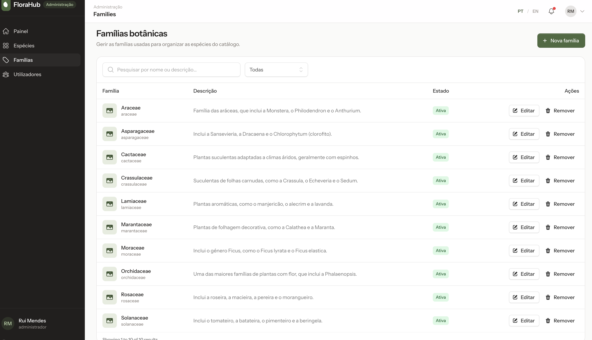

# Guia 05 — Gestão de famílias botânicas (CRUD com Livewire)

No Guia 04 protegemos a área de administração com o papel `admin`. O painel de administração continua a mostrar apenas dados fictícios.

Neste passo vamos criar a **primeira funcionalidade de domínio** da aplicação: a gestão das **famílias botânicas** (ex.: *Araceae*, *Rosaceae*), que mais tarde vão organizar as espécies do catálogo.

Vamos:

1. criar o modelo `Family` com **migration**, **factory** e **seeder**;
2. usar **soft deletes**: remover uma família sem apagar os seus dados;
3. gerar um **slug** a partir do nome;
4. criar **uma única página Livewire** com a listagem, a pesquisa e a paginação;
5. criar e editar famílias num **painel lateral** (_drawer_);
6. remover, restaurar e eliminar definitivamente famílias;
7. comunicar o resultado de cada operação com **toasts**;
8. mostrar o número real de famílias no painel de administração.

No final teremos:


---

**Documentação oficial:**

- Laravel — Migrations: https://laravel.com/docs/13.x/migrations
- Laravel — Eloquent: https://laravel.com/docs/13.x/eloquent
- Laravel — Soft deleting: https://laravel.com/docs/13.x/eloquent#soft-deleting
- Laravel — Factories: https://laravel.com/docs/13.x/eloquent-factories
- Laravel — Seeders: https://laravel.com/docs/13.x/seeding
- Laravel — Validação (`unique`, `regex`): https://laravel.com/docs/13.x/validation#available-validation-rules
- Laravel — Controladores de recurso: https://laravel.com/docs/13.x/controllers#resource-controllers
- Livewire — Páginas: https://livewire.laravel.com/docs/4.x/pages
- Livewire — Propriedades computadas: https://livewire.laravel.com/docs/4.x/computed-properties
- Livewire — Paginação: https://livewire.laravel.com/docs/4.x/pagination
- Livewire — Lifecycle hooks: https://livewire.laravel.com/docs/4.x/lifecycle-hooks
- Livewire — Segurança (middleware persistente): https://livewire.laravel.com/docs/4.x/security
- Flux — Table: https://fluxui.dev/components/table
- Flux — Modal (flyout): https://fluxui.dev/components/modal
- Flux — Toast: https://fluxui.dev/components/toast

---

**Índice**

<!-- TOC -->
* [Guia 05 — Gestão de famílias botânicas (CRUD com Livewire)](#guia-05--gestão-de-famílias-botânicas-crud-com-livewire)
    * [Antes de começar](#antes-de-começar)
    * [0. Conceitos](#0-conceitos)
    * [1. Modelo, migration, factory e seeder](#1-modelo-migration-factory-e-seeder)
    * [2. A página Livewire e a rota](#2-a-página-livewire-e-a-rota)
    * [3. Proteger as ações Livewire](#3-proteger-as-ações-livewire)
    * [4. Preparar o layout: toasts e ligação no menu](#4-preparar-o-layout-toasts-e-ligação-no-menu)
    * [5. Listagem, pesquisa e paginação](#5-listagem-pesquisa-e-paginação)
    * [6. Criar e editar no drawer](#6-criar-e-editar-no-drawer)
    * [7. Remover, restaurar e eliminar definitivamente](#7-remover-restaurar-e-eliminar-definitivamente)
    * [8. Número de famílias no painel de administração](#8-número-de-famílias-no-painel-de-administração)
    * [9. Verificação no browser](#9-verificação-no-browser)
    * [10. Verificação final e commit](#10-verificação-final-e-commit)
    * [11. Resumo](#11-resumo)
    * [12. Problemas comuns](#12-problemas-comuns)
<!-- TOC -->

---

## Antes de começar

### Como utilizar este guia

Este guia foi escrito para ser seguido **de forma autónoma**, depois da aula.

- Seguir os passos **pela ordem indicada**. Cada passo depende do anterior.
- No fim de cada secção existe um bloco **Verificar**. Não avançar sem confirmar que tudo funciona.
- Os blocos **Exercício** devem ser resolvidos antes de continuar.
- Sempre que existe um comando Artisan para criar um ficheiro, **usá-lo**. Não criar ficheiros manualmente.
- Se algo não funcionar, consultar a secção [12. Problemas comuns](#12-problemas-comuns).

### Pré-requisitos

- Guia **04** concluído (papéis `admin`/`user` e utilizadores de desenvolvimento).

- Serviços Docker em execução:

  ```bash
  docker compose up -d
  ```

- Aplicação em execução num terminal próprio:

  ```bash
  composer run dev
  ```

Todos os comandos `php artisan …` e `composer …` são executados noutro terminal, **na raiz do projeto**.

---

## 0. Conceitos

### 0.1. Controlador de recurso vs. componente Livewire

Já sabemos fazer um CRUD "clássico" com um **controlador de recurso**:

```bash
php artisan make:controller FamilyController --resource --model=Family
```

```php
Route::resource('families', FamilyController::class);
```

Neste guia vamos fazer o **mesmo CRUD** de outra forma: com **um único componente Livewire**. É importante perceber o que muda.

**Com um controlador de recurso**, cada operação é um **pedido HTTP completo** e o browser carrega **uma página nova** de cada vez:

```text
GET    /admin/families              index    → lista (vista index.blade.php)
GET    /admin/families/create       create   → formulário (vista create.blade.php)
POST   /admin/families              store    → valida, grava, redirect + session flash
GET    /admin/families/{family}/edit edit    → formulário (vista edit.blade.php)
PUT    /admin/families/{family}     update   → valida, grava, redirect + session flash
DELETE /admin/families/{family}     destroy  → apaga, redirect + session flash
```

**Com Livewire**, existe **uma única rota** e **uma única página**. Os botões chamam **métodos PHP** do componente. O Livewire envia o pedido em segundo plano (AJAX) e atualiza **apenas a parte da página que mudou**:

```text
GET  /admin/families                    → página completa (uma só vez)
POST /livewire-…/update  call: create()  → abre o drawer vazio
POST /livewire-…/update  call: edit(3)   → abre o drawer com a família 3
POST /livewire-…/update  call: save()    → valida, grava, fecha o drawer, mostra um toast
POST /livewire-…/update  call: delete(3) → remove, mostra um toast
```

| | Controlador de recurso | Componente Livewire |
|---|---|---|
| Rotas | 7 (`Route::resource`) | 1 (`Route::livewire`) |
| Onde está o código | controlador + várias vistas | um ficheiro `⚡families.blade.php` (PHP + Blade) |
| Cada ação | pedido HTTP completo, página recarregada | pedido Livewire, só a zona alterada é atualizada |
| Estado do formulário | campos do pedido (`$request`) | **propriedades públicas** do componente (`$this->name`) |
| Validação | `$request->validate()` ou Form Request | `$this->validate()` |
| Depois de gravar | `redirect()->route(...)->with('status', ...)` | continua na mesma página; `Flux::toast(...)` |
| Formulários | `<form method="POST">` + `@csrf` + `@method('PUT')` | `wire:submit="save"` (o CSRF é tratado pelo Livewire) |
| Botão "apagar" | um `<form>` com `@method('DELETE')` por linha | `wire:click="delete(3)"` |
| Drawer / modal sem recarregar | exige JavaScript próprio | natural: o PHP controla o que se mostra |

**Quando escolher cada um?**

- **Controlador:** páginas simples, formulários tradicionais, uma API (JSON), ou quando cada operação deve ter o seu próprio URL.
- **Livewire:** interfaces interativas (painéis laterais, pesquisa enquanto se escreve, toasts) em que se quer escrever **apenas PHP**, sem JavaScript.

Nesta página queremos um drawer, pesquisa "ao vivo" e toasts. Por isso escolhemos **Livewire** e **não criamos nenhum controlador**.

> **Atenção:** uma página Livewire **não** substitui a segurança. Cada método público (`save`, `delete`, …) pode ser chamado por quem abrir a página, tal como uma rota. Vamos tratar disso no passo 3.

### 0.2. Soft deletes

Com _soft deletes_, **remover** uma linha não a apaga da base de dados. O Laravel preenche a coluna `deleted_at` com a data da remoção.

| Código | O que faz |
|--------|-----------|
| `$table->softDeletes()` (migration) | cria a coluna `deleted_at` (`NULL` = ativa) |
| `use SoftDeletes;` (modelo) | ativa o comportamento no modelo |
| `$family->delete()` | preenche `deleted_at` (remoção **lógica**) |
| `$family->trashed()` | `true` se a família foi removida |
| `$family->restore()` | volta a pôr `deleted_at` a `NULL` |
| `$family->forceDelete()` | apaga a linha **definitivamente** |
| `Family::all()` / `Family::find()` | **ignoram** as famílias removidas |
| `Family::withTrashed()` | inclui as removidas |
| `Family::onlyTrashed()` | apenas as removidas |

Nesta aplicação:

- **Remover** → _soft delete_ (pode ser desfeito com **Restaurar**);
- **Eliminar definitivamente** → `forceDelete()`, só disponível para famílias **já removidas**.

### 0.3. Slug

Um **slug** é uma versão do nome segura para usar num URL:

```text
"Araceae"            → araceae
"Asparagaceae Juss." → asparagaceae-juss
```

Vai ser usado mais tarde em endereços como `/families/araceae`. O Laravel gera-o com `Str::slug()`:

```php
Illuminate\Support\Str::slug('Asparagaceae Juss.'); // "asparagaceae-juss"
```

No formulário, o slug é preenchido **automaticamente** a partir do nome, mas o administrador **pode alterá-lo**.

### 0.4. Autorização: por agora, apenas middleware

Quem pode gerir famílias? **Apenas administradores.** Neste guia garantimos isso **só** com o middleware da rota (`role:admin`), que já existe desde o Guia 04.

Mais tarde vamos introduzir **policies** (`FamilyPolicy`), que respondem a perguntas mais finas: *"este utilizador pode editar **esta** família?"*. Para já, a regra é simples (é admin ou não é), e o middleware chega.

### 0.5. A coluna `image`

Cada família terá uma imagem. A coluna `image` é criada **já**, mas fica sempre vazia (`NULL`): o carregamento de imagens será feito num guia futuro. Por agora a tabela mostra apenas um ícone.

---

## 1. Modelo, migration, factory e seeder

### 1.1. Criar os ficheiros

Um único comando cria o modelo e os ficheiros relacionados:

```bash
php artisan make:model Family -mfs
```

| Opção | Cria |
|-------|------|
| `-m` | migration `create_families_table` |
| `-f` | factory `FamilyFactory` |
| `-s` | seeder `FamilySeeder` |

Resultado esperado (a data da migration será diferente):

```text
INFO  Model [app/Models/Family.php] created successfully.
INFO  Factory [database/factories/FamilyFactory.php] created successfully.
INFO  Migration [database/migrations/2026_09_30_164442_create_families_table.php] created successfully.
INFO  Seeder [database/seeders/FamilySeeder.php] created successfully.
```

> **Nomes em inglês.** O modelo é `Family` e a tabela é `families` (plural em inglês, deduzido pelo Laravel). Todo o código e a base de dados ficam em inglês; apenas o texto mostrado ao utilizador está em português.

### 1.2. A migration

Abrir `database/migrations/xxxx_xx_xx_xxxxxx_create_families_table.php` e completar o método `up()`:

```php
    public function up(): void
    {
        Schema::create('families', function (Blueprint $table) {
            $table->id();
            $table->string('name')->unique();
            $table->string('slug')->unique();
            $table->text('description')->nullable();
            $table->string('image')->nullable();
            $table->timestamps();
            $table->softDeletes();
        });
    }
```

| Coluna | Tipo | Notas |
|--------|------|-------|
| `name` | `string` | obrigatório, **único** |
| `slug` | `string` | obrigatório, **único** |
| `description` | `text` | opcional |
| `image` | `string` | opcional; vai guardar o caminho da imagem |
| `created_at`, `updated_at` | `timestamps()` | preenchidos automaticamente pelo Eloquent |
| `deleted_at` | `softDeletes()` | `NULL` enquanto a família está ativa |

**Exercício:** porque é que `description` é `text` e não `string`? (Dica: qual é o tamanho máximo de uma coluna `string` no MySQL?)

Executar a migration:

```bash
php artisan migrate
```

Resultado esperado:

```text
xxxx_xx_xx_xxxxxx_create_families_table ........ DONE
```

> Nunca usar `migrate:fresh` para "resolver" problemas: apaga **todas** as tabelas e os dados.

### 1.3. O modelo

Substituir o conteúdo de `app/Models/Family.php` por:

```php
<?php

namespace App\Models;

use Database\Factories\FamilyFactory;
use Illuminate\Database\Eloquent\Attributes\Fillable;
use Illuminate\Database\Eloquent\Factories\HasFactory;
use Illuminate\Database\Eloquent\Model;
use Illuminate\Database\Eloquent\SoftDeletes;
use Illuminate\Support\Carbon;

/**
 * @property int $id
 * @property string $name
 * @property string $slug
 * @property string|null $description
 * @property string|null $image
 * @property Carbon|null $created_at
 * @property Carbon|null $updated_at
 * @property Carbon|null $deleted_at
 */
#[Fillable(['name', 'slug', 'description', 'image'])]
class Family extends Model
{
    /** @use HasFactory<FamilyFactory> */
    use HasFactory, SoftDeletes;
}
```

Notar:

- `SoftDeletes` ativa a remoção lógica (secção 0.2).
- `#[Fillable]` indica os atributos que podem ser preenchidos com `create()` / `update()` (*mass assignment*). É o mesmo atributo PHP usado no modelo `User`.
- O bloco `@property` documenta as colunas para o editor e para o PHPStan.

### 1.4. A factory

A factory cria famílias **fictícias**, úteis para testes e experiências no `tinker`.

Substituir o método `definition()` de `database/factories/FamilyFactory.php` e acrescentar o `use` de `Str`:

```php
use Illuminate\Support\Str;
```

```php
    public function definition(): array
    {
        $name = Str::ucfirst(fake()->unique()->word()).'aceae';

        return [
            'name' => $name,
            'slug' => Str::slug($name),
            'description' => fake()->sentence(),
            'image' => null,
        ];
    }
```

Os nomes das famílias botânicas terminam em **-aceae**. A factory aproveita isso para gerar nomes como `Doloremaceae`.

### 1.5. O seeder

O seeder cria famílias **reais**. Substituir o conteúdo de `database/seeders/FamilySeeder.php` por:

```php
<?php

namespace Database\Seeders;

use App\Models\Family;
use Illuminate\Database\Seeder;
use Illuminate\Support\Str;

class FamilySeeder extends Seeder
{
    /**
     * Seed the botanical families.
     */
    public function run(): void
    {
        $families = [
            'Araceae' => 'Família das aráceas, que inclui a Monstera, o Philodendron e o Anthurium.',
            'Cactaceae' => 'Plantas suculentas adaptadas a climas áridos, geralmente com espinhos.',
            'Rosaceae' => 'Inclui a roseira, a macieira, a pereira e o morangueiro.',
            // Exercício: acrescentar as restantes famílias
        ];

        foreach ($families as $name => $description) {
            Family::withTrashed()->updateOrCreate(
                ['slug' => Str::slug($name)],
                ['name' => $name, 'description' => $description],
            );
        }
    }
}
```

**Exercício:** substituir o comentário por mais sete famílias, com uma descrição curta cada. Por exemplo: *Asparagaceae*, *Crassulaceae*, *Lamiaceae*, *Marantaceae*, *Moraceae*, *Orchidaceae* e *Solanaceae*.

Notar:

- `updateOrCreate()` procura a família pelo **slug**. Se existir, atualiza-a; senão, cria-a. Assim o seeder pode ser executado **várias vezes** sem duplicar famílias (é **idempotente**, como os seeders do Guia 04).
- `withTrashed()` é necessário porque, com `SoftDeletes`, as consultas **ignoram** as famílias removidas. Sem ele, o seeder não encontraria uma família removida e tentaria criá-la de novo, violando o índice `unique`.

### 1.6. Registar o seeder

As famílias são dados reais da aplicação (não são só de desenvolvimento). Em `database/seeders/DatabaseSeeder.php`, substituir:

```php
        $this->call(RoleSeeder::class);
```

por:

```php
        $this->call([
            RoleSeeder::class,
            FamilySeeder::class,
        ]);
```

Executar apenas o novo seeder:

```bash
php artisan db:seed --class=FamilySeeder
```

### 1.7. Verificar

```bash
php artisan tinker
```

```php
App\Models\Family::count();                    // 10

$f = App\Models\Family::firstWhere('slug', 'rosaceae');
$f->delete();                                  // soft delete
$f->trashed();                                 // true
App\Models\Family::count();                    // 9  → a removida é ignorada
App\Models\Family::withTrashed()->count();     // 10
App\Models\Family::onlyTrashed()->pluck('name'); // ["Rosaceae"]

$f->restore();
App\Models\Family::count();                    // 10
exit
```

**Exercício:** antes do `restore()`, abrir a tabela `families` num cliente de base de dados (ex.: TablePlus, DBeaver ou o painel de base de dados do PhpStorm). A linha *Rosaceae* continua lá? O que tem a coluna `deleted_at`?

---

## 2. A página Livewire e a rota

### 2.1. Criar o componente

Tal como as páginas de definições do Starter Kit (`pages/settings/⚡profile.blade.php`), a gestão de famílias é um **componente Livewire de página completa**, escrito num **único ficheiro** (PHP + Blade).

```bash
php artisan make:livewire pages::admin.families
```

Resultado esperado:

```text
INFO  Livewire component [resources/views/pages/admin/⚡families.blade.php] created successfully.
```

O ficheiro tem duas partes:

```blade
<?php

use Livewire\Component;

new class extends Component
{
    //
};
?>

<div>
    {{-- ... --}}
</div>
```

- **Em cima**, entre `<?php` e `?>`: a classe do componente (propriedades e métodos PHP).
- **Em baixo**: a vista Blade. Tem de ter **um único elemento raiz** (o `<div>`).

Vamos preenchê-lo ao longo dos próximos passos.

### 2.2. Layout e título

A página tem de usar o **layout de administração** (`layouts/admin.blade.php`), e não o layout por omissão do Starter Kit.

Substituir a parte PHP do ficheiro por:

```php
<?php

use Livewire\Attributes\Layout;
use Livewire\Attributes\Title;
use Livewire\Component;

new #[Layout('layouts::admin')] #[Title('Famílias')] class extends Component {
    //
};
?>
```

- `#[Layout('layouts::admin')]` → usa `resources/views/layouts/admin.blade.php`; o conteúdo da página vai para o `{{ $slot }}`.
- `#[Title('Famílias')]` → chega ao layout como `$title` (título do separador e do cabeçalho).

E substituir a vista por um título provisório:

```blade
<div>
    <h2 class="text-2xl font-semibold tracking-tight text-stone-900">Famílias botânicas</h2>
</div>
```

### 2.3. A rota

Em `routes/web.php`, dentro do grupo de administração, acrescentar a rota da página **depois** da rota `dashboard`:

```php
Route::middleware(['auth', 'verified', 'role:admin'])
    ->prefix('admin')
    ->name('admin.')
    ->group(function () {
        Route::view('dashboard', 'admin.dashboard')->name('dashboard');

        Route::livewire('families', 'pages::admin.families')->name('families.index');
    });
```

- `Route::livewire()` liga o URL ao componente, **sem controlador**.
- Por estar dentro do grupo, o URL final é `/admin/families` e o nome é `admin.families.index`.
- Usamos `families.index` (e não só `families`) por coerência com os nomes dos controladores de recurso, e para que `admin.families.*` identifique toda a gestão de famílias.

### 2.4. Verificar

```bash
php artisan route:list --path=admin
```

Resultado esperado:

```text
GET|HEAD  admin/dashboard .... admin.dashboard
GET|HEAD  admin/families ..... admin.families.index › Livewire\Mechanisms › …
```

Iniciar sessão como `admin@florahub.test` e abrir `http://localhost:8000/admin/families`:

- [ ] aparece o título **Famílias botânicas** dentro do layout de administração;
- [ ] o separador do browser mostra **Famílias - FloraHub**.

Iniciar sessão como `user@florahub.test` e abrir o mesmo endereço:

- [ ] **403**.

---

## 3. Proteger as ações Livewire

### 3.1. O problema

A rota `/admin/families` está protegida com `role:admin`. Mas, como vimos em 0.1, **os botões não chamam essa rota**: chamam `POST /livewire-…/update`, que é uma rota do próprio Livewire.

O Livewire guarda o URL da página original e, em cada pedido de atualização, volta a aplicar **alguns** middlewares dessa rota: os chamados **middlewares persistentes**. Por omissão, a lista inclui o `auth`, mas **não** inclui o middleware `role` do Spatie.

Sem mais nada, um utilizador **com sessão iniciada mas sem o papel `admin`** que conseguisse enviar um pedido Livewire para esta página **conseguiria executar as ações** (por exemplo, remover uma família).

### 3.2. Tornar o middleware `role` persistente

Em `app/Providers/AppServiceProvider.php`, acrescentar os `use`:

```php
use Livewire\Livewire;
use Spatie\Permission\Middleware\RoleMiddleware;
```

No método `boot()`, chamar um novo método:

```php
    public function boot(): void
    {
        $this->configureDefaults();
        $this->configureLivewire();
    }
```

E acrescentar o método à classe:

```php
    /**
     * Re-apply the role middleware to every Livewire request made from a protected page.
     */
    protected function configureLivewire(): void
    {
        Livewire::addPersistentMiddleware([
            RoleMiddleware::class,
        ]);
    }
```

A partir de agora, cada pedido Livewire feito a partir de `/admin/families` volta a verificar `role:admin`. Um utilizador sem esse papel recebe **403**.

### 3.3. Verificar

```bash
php artisan tinker
```

```php
in_array(Spatie\Permission\Middleware\RoleMiddleware::class, Livewire\Livewire::getPersistentMiddleware()); // true
exit
```

> **Regra a reter:** numa página Livewire, as **ações** também são pontos de entrada da aplicação e têm de ser protegidas, tal como as rotas.

---

## 4. Preparar o layout: toasts e ligação no menu

### 4.1. Toasts e scripts do Flux no layout dos painéis

Os toasts são mostrados pelo componente `<flux:toast />`, que tem de estar **no layout**. O drawer e os toasts precisam também dos guias do Flux (`@fluxScripts`). Os layouts do Starter Kit já os têm; o nosso `layouts/dashboard.blade.php` (criado no Guia 03.5) ainda não.

Abrir `resources/views/layouts/dashboard.blade.php`.

**a)** Imediatamente antes de `</body>`, acrescentar:

```blade
        <flux:toast.group>
            <flux:toast />
        </flux:toast.group>

        @fluxScripts
```

**b)** O design dos painéis é **apenas claro**. Agora que vamos usar componentes Flux (tabela, campos, botões), é preciso impedir o modo escuro, tal como fizemos no layout de autenticação no Guia 04 (passo 9.3). Acrescentar no `<head>`, depois do `@include('partials.head')`:

```blade
        {{-- O design dos painéis é apenas claro: remove o modo escuro sem alterar a preferência guardada --}}
        <script>
            window.Flux.applyAppearance = () => document.documentElement.classList.remove('dark');
            window.Flux.applyAppearance();
        </script>
```

Como o layout `dashboard` é partilhado, estas alterações servem os dois painéis (admin e utilizador).

### 4.2. Ligação "Famílias" na barra lateral

Em `resources/views/layouts/admin.blade.php`, a ligação **Famílias** ainda aponta para `#`.

**Exercício:** transformá-la numa ligação real para a rota `admin.families.index`, destacada quando está ativa. Seguir o **mesmo padrão** da ligação **Painel** logo acima (`href="{{ route(...) }}"` e `@class([...])` com `request()->routeIs(...)`).

Dica: para que a ligação fique ativa em **qualquer** rota de famílias, usar `request()->routeIs('admin.families.*')`.

```bladehtml
<a href="{{ route('admin.families.index') }}" @class([
            'flex items-center gap-3 rounded-lg border-l-2 px-3 py-2 text-sm font-medium',
            'border-brand-500 bg-white/5 text-white' => request()->routeIs('admin.families.*'),
            'border-transparent text-stone-300 hover:bg-white/5 hover:text-white' => ! request()->routeIs('admin.families.*'),
        ])>
            <svg class="h-5 w-5" viewBox="0 0 24 24" fill="none" stroke="currentColor" stroke-width="1.5"><path stroke-linecap="round" stroke-linejoin="round" d="M9.568 3H5.25A2.25 2.25 0 003 5.25v4.318c0 .597.237 1.17.659 1.591l9.581 9.581c.699.699 1.78.872 2.607.33a18.095 18.095 0 005.223-5.223c.542-.827.369-1.908-.33-2.607L11.16 3.66A2.25 2.25 0 009.568 3z"/><path stroke-linecap="round" stroke-linejoin="round" d="M6 6h.008v.008H6V6z"/></svg>
            Famílias
        </a>
```

### 4.3. Verificar

- [ ] Na área de administração, clicar em **Famílias** abre `/admin/families`.
- [ ] Nessa página, a ligação **Famílias** aparece destacada e **Painel** deixa de estar.
- [ ] Com o sistema operativo em modo escuro, o painel continua claro.

---

## 5. Listagem, pesquisa e paginação

### 5.1. A consulta: uma propriedade computada

Na parte PHP de `⚡families.blade.php`, acrescentar os `use` necessários:

```php
use App\Models\Family;
use Illuminate\Contracts\Pagination\LengthAwarePaginator;
use Livewire\Attributes\Computed;
use Livewire\Attributes\Layout;
use Livewire\Attributes\Title;
use Livewire\Component;
use Livewire\WithPagination;
```

E, dentro da classe (no lugar do `//`):

```php
    use WithPagination;

    public string $search = '';

    /**
     * All families, including the soft deleted ones, filtered by the search term.
     *
     * @return LengthAwarePaginator<int, Family>
     */
    #[Computed]
    public function families(): LengthAwarePaginator
    {
        return Family::withTrashed()
            ->when($this->search !== '', function ($query) {
                $query->where('name', 'like', "%{$this->search}%");
            })
            ->orderBy('name')
            ->paginate(15);
    }

    /**
     * Go back to the first page whenever the search term changes.
     */
    public function updatedSearch(): void
    {
        $this->resetPage();
    }
```

Notar:

| Código | Função |
|--------|--------|
| `use WithPagination;` | trait do Livewire: a paginação muda de página **sem recarregar** |
| `public string $search` | propriedade pública: fica ligada ao campo de pesquisa |
| `#[Computed]` | a consulta fica disponível na vista como `$this->families` |
| `withTrashed()` | o administrador vê **todas** as famílias, incluindo as removidas |
| `when(condição, fn)` | só acrescenta o `where` se houver texto de pesquisa |
| `paginate(15)` | 15 famílias por página |
| `updatedSearch()` | *lifecycle hook*: corre sempre que `$search` muda; volta à página 1 |

> **Porque não guardar as famílias numa propriedade pública** (`public $families`)? As propriedades públicas são enviadas para o browser em cada pedido. Uma propriedade computada é calculada no servidor e **não** é enviada.

**Exercício:** a pesquisa só procura no **nome**. Alterar a consulta para procurar **no nome ou na descrição**.

Dica: use `orWhere`, mas **agrupe** as duas condições dentro de um `where(function ($query) { ... })`. Assim, no SQL gerado, ficam entre parênteses:

```sql
... WHERE (name LIKE ? OR description LIKE ?) ...
```

Sem o agrupamento, se mais tarde for acrescentado outro filtro (por exemplo, "apenas ativas"), o `OR` misturava-se com esse filtro e a consulta devolvia resultados errados.

### 5.2. A vista: cabeçalho e pesquisa

Substituir a vista (a parte depois de `?>`) por:

```blade
<div>
    <div class="flex flex-wrap items-end justify-between gap-4">
        <div>
            <h2 class="text-2xl font-semibold tracking-tight text-stone-900">Famílias botânicas</h2>
            <p class="mt-1 text-sm text-stone-500">Gerir as famílias usadas para organizar as espécies do catálogo.</p>
        </div>

        <flux:button variant="primary" icon="plus">Nova família</flux:button>
    </div>

    <div class="mt-6 overflow-hidden rounded-2xl border border-stone-200 bg-white">
        <div class="border-b border-stone-200 p-4">
            <flux:input
                wire:model.live.debounce.300ms="search"
                icon="magnifying-glass"
                placeholder="Pesquisar por nome ou descrição…"
                class="max-w-sm"
            />
        </div>

        <div class="px-4 [--flux-bleed:1rem]">
            {{-- Tabela: passo 5.3 --}}
        </div>
    </div>
</div>
```

`wire:model.live.debounce.300ms="search"`:

- `wire:model="search"` liga o campo à propriedade `$search`;
- `.live` envia o valor enquanto se escreve (sem `.live`, só seria enviado na ação seguinte);
- `.debounce.300ms` espera 300 ms depois da última tecla, para não fazer um pedido por cada letra.

### 5.3. A tabela

Substituir o comentário `{{-- Tabela: passo 5.3 --}}` por:

```blade
            <flux:table bleed :paginate="$this->families">
                <flux:table.columns>
                    <flux:table.column>Família</flux:table.column>
                    <flux:table.column>Descrição</flux:table.column>
                    <flux:table.column>Estado</flux:table.column>
                    <flux:table.column align="end">Ações</flux:table.column>
                </flux:table.columns>

                <flux:table.rows>
                    @forelse ($this->families as $family)
                        <flux:table.row :key="$family->id" @class(['bg-red-50' => $family->trashed()])>
                            <flux:table.cell>
                                <div class="flex items-center gap-3">
                                    {{-- Imagem da família: o carregamento de imagens será implementado numa tarefa futura --}}
                                    <span @class([
                                        'flex h-10 w-10 flex-none items-center justify-center rounded-lg',
                                        'bg-brand-100 text-brand-700' => ! $family->trashed(),
                                        'bg-red-100 text-red-600' => $family->trashed(),
                                    ])>
                                        <flux:icon.photo variant="mini" />
                                    </span>
                                    <div>
                                        <p @class([
                                            'font-medium',
                                            'text-stone-900' => ! $family->trashed(),
                                            'text-red-700 line-through' => $family->trashed(),
                                        ])>{{ $family->name }}</p>
                                        <p @class(['text-xs', 'text-stone-500' => ! $family->trashed(), 'text-red-500' => $family->trashed()])>{{ $family->slug }}</p>
                                    </div>
                                </div>
                            </flux:table.cell>

                            <flux:table.cell @class(['max-w-md whitespace-normal', 'text-red-600' => $family->trashed()])>
                                {{ Str::limit($family->description, 90) }}
                            </flux:table.cell>

                            <flux:table.cell>
                                {{-- Exercício: badge "Ativa" ou "Removida" --}}
                            </flux:table.cell>

                            <flux:table.cell align="end">
                                {{-- Botões de ação: passos 6 e 7 --}}
                            </flux:table.cell>
                        </flux:table.row>
                    @empty
                        <flux:table.row>
                            <flux:table.cell colspan="4" class="py-10 text-center text-stone-500">
                                Nenhuma família encontrada.
                            </flux:table.cell>
                        </flux:table.row>
                    @endforelse
                </flux:table.rows>
            </flux:table>
```

Notar:

- `:paginate="$this->families"` faz a tabela mostrar os controlos de paginação.
- `:key="$family->id"` identifica cada linha. O Livewire usa-a para atualizar só as linhas que mudaram. **Todos os ciclos** numa vista Livewire devem ter uma chave.
- `$family->trashed()` decide as cores: as famílias removidas aparecem **a vermelho**.
- `@forelse … @empty` mostra uma mensagem quando a pesquisa não encontra nada.

**Exercício:** substituir o comentário da coluna **Estado** por um `<flux:badge size="sm">`: verde (`color="green"`) com o texto **Ativa**, ou vermelho (`color="red"`) com o texto **Removida**, conforme `$family->trashed()`.

### 5.4. Verificar

Abrir `http://localhost:8000/admin/families` como administrador:

- [ ] aparecem as 10 famílias do seeder, por ordem alfabética;
- [ ] escrever `rose` na pesquisa → aparece só *Rosaceae*, **sem recarregar a página**;
- [ ] escrever `suculentas` → aparece *Cactaceae* (pesquisa na descrição, exercício 5.1);
- [ ] escrever `xyz` → "Nenhuma família encontrada.";
- [ ] no `tinker`, remover uma família (`App\Models\Family::first()->delete();`) e recarregar a página → essa linha aparece a vermelho, riscada, com o badge **Removida**.

**Exercício:** criar 20 famílias fictícias com a factory e confirmar que a paginação aparece e funciona. No `tinker`, guardar primeiro o maior `id` existente, para depois saber quais são as famílias fictícias:

```php
$last = App\Models\Family::withTrashed()->max('id');
App\Models\Family::factory()->count(20)->create();
```

Recarregar a página: devem aparecer os controlos de paginação e 15 famílias por página. Mudar de página e confirmar que a página **não** recarrega.

No **mesmo** `tinker`, apagar definitivamente as famílias fictícias:

```php
App\Models\Family::withTrashed()->where('id', '>', $last)->forceDelete();
```

---

## 6. Criar e editar no drawer

### 6.1. O estado do formulário

Com Livewire, os campos do formulário são **propriedades públicas** do componente. Acrescentar, depois de `public string $search = '';`:

```php
    public ?int $editingId = null;
    public string $name = '';
    public string $slug = '';
    public string $description = '';
```

`$editingId` indica o que o drawer está a fazer:

- `null` → a **criar** uma família nova;
- um número → a **editar** a família com esse `id`.

Acrescentar os `use`:

```php
use Flux\Flux;
use Illuminate\Support\Str;
use Illuminate\Validation\Rule;
```

### 6.2. Abrir o drawer

Acrescentar os métodos seguintes à classe:

```php
    /**
     * Open the drawer with an empty form.
     */
    public function create(): void
    {
        $this->resetForm();

        Flux::modal('family-form')->show();
    }

    /**
     * Open the drawer with the family's data.
     */
    public function edit(int $id): void
    {
        $family = Family::findOrFail($id);

        $this->resetForm();
        $this->editingId = $family->id;
        $this->name = $family->name;
        $this->slug = $family->slug;
        $this->description = $family->description ?? '';

        Flux::modal('family-form')->show();
    }

    /**
     * Clear the form fields and validation errors.
     */
    protected function resetForm(): void
    {
        $this->reset('editingId', 'name', 'slug', 'description');
        $this->resetValidation();
    }
```

Notar:

- `Flux::modal('family-form')->show()` abre, **a partir do PHP**, o modal com o nome `family-form`.
- `findOrFail()` devolve **404** se o `id` não existir. Como **não** usa `withTrashed()`, também não permite editar uma família removida.
- `resetForm()` é `protected`: pode ser usado dentro do componente, mas **não** pode ser chamado a partir do browser. Só os métodos `public` são ações.

### 6.3. Gravar

```php
    /**
     * Create or update the family.
     */
    public function save(): void
    {
        $validated = $this->validate([
            'name' => ['required', 'string', 'max:255', Rule::unique('families', 'name')->ignore($this->editingId)],
            'slug' => ['required', 'string', 'max:255', 'regex:/^[a-z0-9]+(?:-[a-z0-9]+)*$/', Rule::unique('families', 'slug')->ignore($this->editingId)],
            'description' => ['nullable', 'string', 'max:2000'],
        ]);

        $validated['description'] = $validated['description'] ?: null;

        if ($this->editingId === null) {
            Family::create($validated);

            Flux::toast(variant: 'success', text: 'Família criada.');
        } else {
            Family::findOrFail($this->editingId)->update($validated);

            Flux::toast(variant: 'success', text: 'Família atualizada.');
        }

        Flux::modal('family-form')->close();

        $this->resetForm();
    }
```

Notar:

- `$this->validate([...])` valida as **propriedades** do componente. Se falhar, o método pára e os erros aparecem no formulário, com o drawer aberto.
- `Rule::unique('families', 'name')->ignore($this->editingId)`: o nome não pode existir noutra família, **exceto na própria** que estamos a editar. Ao criar, `editingId` é `null` e nada é ignorado.
- A regra `unique` consulta a tabela diretamente e **não** ignora as linhas com `deleted_at`. Por isso o nome e o slug de uma família **removida** continuam ocupados. É intencional: se outra família pudesse usar o mesmo nome, restaurar a removida criaria um duplicado.
- A expressão regular aceita apenas letras minúsculas, números e hífenes (ex.: `araceae`, `asparagaceae-juss`).
- Uma descrição vazia (`''`) é gravada como `NULL`.
- `Flux::toast(...)` mostra a notificação. É o equivalente Livewire do `redirect()->with('status', ...)` de um controlador.

### 6.4. O slug automático

Queremos que o slug acompanhe o nome **enquanto** o administrador não o alterar à mão. Acrescentar:

```php
    /**
     * Keep the slug in sync with the name until the admin edits the slug by hand.
     */
    public function updatingName(string $value): void
    {
        if ($this->slug === Str::slug($this->name)) {
            $this->slug = Str::slug($value);
        }
    }
```

`updatingName()` é um *lifecycle hook*: o Livewire chama-o **antes** de alterar `$name`. Nesse momento:

- `$this->name` ainda tem o **valor antigo**;
- `$value` tem o **valor novo**.

Se o slug atual é o slug do nome antigo, o administrador não lhe mexeu: atualizamo-lo. Se forem diferentes, foi alterado à mão e não lhe tocamos.

**Exercício:** qual é a diferença entre `updatingName()` e `updatedName()`? Porque é que aqui precisamos de `updating`?

### 6.5. O drawer

Na vista, antes do `</div>` final (ou seja, ainda dentro do elemento raiz), acrescentar:

```blade
    <flux:modal name="family-form" flyout class="md:w-lg">
        <form wire:submit="save" class="space-y-6">
            <div>
                <flux:heading size="lg">{{ $editingId ? 'Editar família' : 'Nova família' }}</flux:heading>
                <flux:text class="mt-2">Os campos marcados com * são obrigatórios.</flux:text>
            </div>

            <flux:input wire:model.blur="name" label="Nome *" placeholder="Ex.: Araceae" />

            <flux:input
                wire:model="slug"
                label="Slug *"
                description="Identificador usado nos endereços. É gerado a partir do nome, mas pode ser alterado."
                placeholder="Ex.: araceae"
            />

            <flux:textarea wire:model="description" label="Descrição" rows="5" />

            <div class="flex justify-end gap-2">
                <flux:modal.close>
                    <flux:button variant="ghost">Cancelar</flux:button>
                </flux:modal.close>

                <flux:button type="submit" variant="primary">Guardar</flux:button>
            </div>
        </form>
    </flux:modal>
```

Notar:

- `flyout` transforma o modal num **painel lateral** que abre da direita.
- `name="family-form"` é o nome usado em `Flux::modal('family-form')`.
- `wire:submit="save"` chama o método `save()`. Não é preciso `@csrf` nem `method="POST"`.
- `wire:model.blur="name"` envia o nome quando o campo **perde o foco**. É aí que o `updatingName()` corre e o slug é preenchido.
- Os campos Flux com `wire:model` mostram automaticamente os erros de validação.

### 6.6. Os botões

**a)** No cabeçalho, ligar o botão **Nova família** ao método `create()`:

```blade
        <flux:button variant="primary" icon="plus" wire:click="create">Nova família</flux:button>
```

**b)** Na coluna **Ações**, substituir o comentário por:

```blade
                                <div class="flex justify-end gap-2">
                                    @if ($family->trashed())
                                        {{-- Passo 7 --}}
                                    @else
                                        <flux:button size="sm" icon="pencil-square" wire:click="edit({{ $family->id }})">Editar</flux:button>
                                    @endif
                                </div>
```

`wire:click="edit(3)"` chama `edit(3)` no servidor. O argumento é o `id` da família.

### 6.7. Verificar

- [ ] **Nova família** abre o drawer vazio, com o título "Nova família".
- [ ] Escrever `Asteraceae` no nome e passar para o campo seguinte → o slug fica `asteraceae`.
- [ ] Alterar o slug para `compostas`, voltar ao nome e alterá-lo → o slug **mantém-se** `compostas`.
- [ ] **Guardar** → o drawer fecha, aparece o toast **Família criada.** e a família aparece na tabela.
- [ ] **Guardar** com o nome vazio → aparecem erros e o drawer **fica aberto**.
- [ ] Tentar criar outra família chamada `Araceae` → erro de nome e slug já existentes.
- [ ] Slug `Ara ceae!` → erro de formato.
- [ ] **Editar** uma família → o drawer abre preenchido, com o título "Editar família".
- [ ] Alterar só a descrição e **Guardar** → toast **Família atualizada.** (o nome da própria família **não** dá erro de duplicado).
- [ ] **Cancelar** fecha o drawer sem gravar.

> As mensagens de validação ainda aparecem em inglês. A tradução será feita num guia futuro.

---

## 7. Remover, restaurar e eliminar definitivamente

### 7.1. Remover (soft delete)

Acrescentar à classe:

```php
    /**
     * Soft delete the family.
     */
    public function delete(int $id): void
    {
        Family::findOrFail($id)->delete();

        Flux::toast(variant: 'warning', text: 'Família removida.');
    }
```

E, na vista, **depois** do botão **Editar**:

```blade
                                        <flux:button size="sm" variant="ghost" icon="trash" wire:click="delete({{ $family->id }})">Remover</flux:button>
```

Como o modelo usa `SoftDeletes`, `delete()` apenas preenche `deleted_at`. A linha continua na tabela, agora a vermelho.

### 7.2. Eliminar definitivamente

```php
    /**
     * Permanently delete a soft deleted family.
     */
    public function forceDelete(int $id): void
    {
        Family::onlyTrashed()->findOrFail($id)->forceDelete();

        Flux::toast(variant: 'danger', text: 'Família eliminada definitivamente.');
    }
```

`onlyTrashed()` garante a regra de negócio **no servidor**: só uma família **já removida** pode ser eliminada definitivamente. Se alguém chamar `forceDelete()` com o `id` de uma família ativa, recebe **404**, mesmo que o botão não apareça na página.

Na vista, substituir o comentário `{{-- Passo 7 --}}` por:

```blade
                                        {{-- Próxima tarefa: pedir confirmação num modal antes de eliminar definitivamente --}}
                                        <flux:button size="sm" variant="danger" icon="trash" wire:click="forceDelete({{ $family->id }})">Eliminar definitivamente</flux:button>
```

> Por agora, **Eliminar definitivamente** apaga logo, sem pedir confirmação. No próximo guia vamos colocar um **modal de confirmação** à frente deste botão. O método `forceDelete()` fica igual.

### 7.3. Restaurar

**Exercício:** criar o método `restore(int $id)` e o botão **Restaurar**.

- O método deve encontrar a família **apenas entre as removidas** (tal como `forceDelete()`), restaurá-la e mostrar o toast **Família restaurada.** com `variant: 'success'`.
- O botão deve aparecer **antes** de **Eliminar definitivamente**, com `size="sm"` e `icon="arrow-uturn-left"`.

### 7.4. Verificar

- [ ] **Remover** uma família → toast **Família removida.**; a linha fica vermelha e riscada, com o badge **Removida**.
- [ ] Uma família removida mostra **Restaurar** e **Eliminar definitivamente**, e **não** mostra **Editar** nem **Remover**.
- [ ] **Restaurar** → toast **Família restaurada.**; a linha volta ao normal.
- [ ] **Remover** e depois **Eliminar definitivamente** → toast **Família eliminada definitivamente.**; a linha desaparece.
- [ ] No `tinker`, `App\Models\Family::withTrashed()->where('name', '...')->exists()` devolve `false` para a família eliminada.

---

## 8. Número de famílias no painel de administração

O cartão **Famílias botânicas** do painel de administração mostra o valor fictício `14`. Vamos mostrar o número real.

### 8.1. Enviar o valor para a vista

A rota do painel usa `Route::view()`, que só mostra uma vista, sem dados. Em `routes/web.php`, substituir:

```php
        Route::view('dashboard', 'admin.dashboard')->name('dashboard');
```

por:

```php
        Route::get('dashboard', function () {
            return view('admin.dashboard', [
                'familiesCount' => Family::count(),
            ]);
        })->name('dashboard');
```

E acrescentar, no topo do ficheiro:

```php
use App\Models\Family;
```

`Family::count()` conta apenas as famílias **ativas** (o `SoftDeletes` ignora as removidas).

> Para uma única linha de código, uma *closure* na rota chega. Se o painel passar a precisar de mais dados, passaremos a usar um controlador.

### 8.2. Mostrar o valor

Em `resources/views/admin/dashboard.blade.php`, no cartão **Famílias botânicas**, substituir `value="14"` por:

```blade
:value="$familiesCount"
```

O `:` antes do atributo indica que o valor é uma **expressão PHP** e não texto.

### 8.3. Verificar

- [ ] O painel de administração mostra **10** famílias (ou o número atual).
- [ ] Remover uma família em **Famílias** e voltar ao painel → o número diminui 1.
- [ ] Restaurá-la → o número volta ao valor anterior.

---

## 9. Verificação no browser

Iniciar sessão como **administrador** (`admin@florahub.test` / `password`, ou o início de sessão rápido):

- [ ] A barra lateral tem a ligação **Famílias**, destacada em `/admin/families`.
- [ ] A tabela mostra todas as famílias, ordenadas pelo nome, 15 por página.
- [ ] A pesquisa filtra por nome e por descrição, sem recarregar a página.
- [ ] Criar, editar, remover, restaurar e eliminar definitivamente funcionam, cada uma com o seu toast.
- [ ] As famílias removidas aparecem a vermelho.
- [ ] O painel mostra o número real de famílias.

Iniciar sessão como **utilizador** (`user@florahub.test` / `password`):

- [ ] `http://localhost:8000/admin/families` → **403**.

---

## 10. Verificação final e commit

### 10.1. Formatação, análise estática e build

```bash
vendor/bin/pint --dirty
composer run types:check
npm run build
```

Os três comandos devem terminar **sem erros**.

### 10.2. Ficheiros alterados

```bash
git status
```

Resultado esperado:

```text
modified:   app/Providers/AppServiceProvider.php
modified:   database/seeders/DatabaseSeeder.php
modified:   resources/views/admin/dashboard.blade.php
modified:   resources/views/layouts/admin.blade.php
modified:   resources/views/layouts/dashboard.blade.php
modified:   routes/web.php

new:        app/Models/Family.php
new:        database/factories/FamilyFactory.php
new:        database/migrations/xxxx_xx_xx_xxxxxx_create_families_table.php
new:        database/seeders/FamilySeeder.php
new:        resources/views/pages/admin/⚡families.blade.php
```

> Em Windows, o nome `⚡families.blade.php` pode aparecer escapado no terminal (ex.: `"\342\232\241families.blade.php"`). É apenas a forma como o Git mostra o emoji.

Fazer commit e push com uma mensagem como:

```text
Gestão de famílias botânicas com Livewire, soft deletes, drawer e toasts
```

---

## 11. Resumo

### 11.1. O mesmo CRUD: controlador vs. Livewire

| Operação | Controlador de recurso | Neste guia (Livewire) |
|----------|------------------------|-------------------------|
| Listar | `index()` + `GET /families` | `families()` (`#[Computed]`) |
| Pesquisar | `?search=` na query string + `$request->query()` | `wire:model.live="search"` |
| Paginar | `paginate()` + `{{ $families->links() }}` | `WithPagination` + `:paginate` na tabela |
| Mostrar formulário de criação | `create()` + vista própria | `create()` → abre o drawer |
| Gravar novo | `store(Request)` + redirect | `save()` com `editingId = null` + toast |
| Mostrar formulário de edição | `edit(Family)` + vista própria | `edit($id)` → abre o drawer preenchido |
| Gravar alterações | `update(Request, Family)` + redirect | `save()` com `editingId` + toast |
| Apagar | `destroy(Family)` + redirect | `delete($id)` + toast |
| Proteção | middleware da rota | middleware da rota **+ middleware persistente** nas ações |

### 11.2. Onde está cada responsabilidade

| Responsabilidade | Ficheiro |
|------------------|----------|
| Estrutura da tabela `families` | migration `create_families_table` |
| Modelo, *mass assignment* e soft deletes | `app/Models/Family.php` |
| Famílias fictícias (testes, tinker) | `database/factories/FamilyFactory.php` |
| Famílias reais | `database/seeders/FamilySeeder.php` |
| URL e proteção da página | `routes/web.php` (`Route::livewire`, grupo `admin`) |
| Proteção das ações Livewire | `AppServiceProvider::configureLivewire()` |
| Listagem, formulário e operações | `resources/views/pages/admin/⚡families.blade.php` |
| Toasts e scripts Flux | `resources/views/layouts/dashboard.blade.php` |
| Ligação no menu | `resources/views/layouts/admin.blade.php` |
| Contador do painel | `routes/web.php` + `admin/dashboard.blade.php` |

### 11.3. Conceitos trabalhados

| Conceito | Onde |
|----------|------|
| Controlador de recurso vs. componente Livewire | secção 0.1 |
| `make:model` com `-mfs` | passo 1.1 |
| Migration com `unique`, `nullable`, `timestamps`, `softDeletes` | passo 1.2 |
| Soft deletes (`delete`, `restore`, `forceDelete`, `withTrashed`, `onlyTrashed`, `trashed`) | secções 0.2, 1.7, 7 |
| `#[Fillable]` (*mass assignment*) | passo 1.3 |
| Factories e seeders idempotentes (`updateOrCreate`) | passos 1.4 e 1.5 |
| Slug com `Str::slug()` | secção 0.3, passo 6.4 |
| Página Livewire de ficheiro único, `#[Layout]`, `#[Title]` | secção 2 |
| `Route::livewire()` | passo 2.3 |
| Middleware persistente do Livewire | secção 3 |
| Propriedades computadas (`#[Computed]`) | passo 5.1 |
| `when()` e agrupamento de condições | passo 5.1 |
| Paginação Livewire (`WithPagination`, `resetPage`) | passo 5.1 |
| `wire:model` com `.live`, `.debounce`, `.blur` | passos 5.2 e 6.5 |
| `wire:click`, `wire:submit`, `wire:key` | passos 5.3, 6.5, 6.6 |
| Lifecycle hooks (`updatedSearch`, `updatingName`) | passos 5.1 e 6.4 |
| Validação em Livewire, `Rule::unique()->ignore()`, `regex` | passo 6.3 |
| Flux: `table`, `badge`, `modal flyout`, `toast` | secções 5–7 |
| Métodos `public` (ações) vs. `protected` | passo 6.2 |
| Autorização por middleware (policies ficam para mais tarde) | secção 0.4 |
| Dados para a vista a partir da rota | secção 8 |

### 11.4. Comandos utilizados

```bash
# Modelo e base de dados
php artisan make:model Family -mfs
php artisan migrate
php artisan db:seed --class=FamilySeeder
php artisan tinker

# Livewire
php artisan make:livewire pages::admin.families

# Rotas
php artisan route:list --path=admin

# Qualidade e build
vendor/bin/pint --dirty
composer run types:check
npm run build
```

---

## 12. Problemas comuns

| Sintoma | Causa provável | Solução |
|---------|----------------|---------|
| `Base table or view not found: 'families'` | Migration não executada | `php artisan migrate` |
| `Unable to find component: [pages::admin.families]` | O ficheiro não está em `resources/views/pages/admin/` ou o nome não tem o `⚡` | Criar o componente com o comando do passo 2.1 |
| A página abre com o layout do Starter Kit (barra lateral cinzenta) | Falta `#[Layout('layouts::admin')]` | Rever o passo 2.2 |
| `Route [admin.families.index] not defined.` | Rota em falta ou fora do grupo `admin` | Rever o passo 2.3 e executar `php artisan route:clear` |
| `Add fillable property [name] to allow mass assignment` | `#[Fillable]` em falta ou incompleto | Rever o passo 1.3 |
| `Call to undefined method ...::trashed()` / `withTrashed()` | Falta o trait `SoftDeletes` | Rever o passo 1.3 |
| `Column not found: 'deleted_at'` | Falta `$table->softDeletes()` na migration | **Não** alterar a migration já executada: criar uma nova com `php artisan make:migration add_soft_deletes_to_families_table --table=families` e acrescentar `$table->softDeletes();` |
| `Duplicate entry ... for key 'families_slug_unique'` ao executar o seeder | Falta `withTrashed()` no `updateOrCreate()` e existe uma família removida | Rever o passo 1.5 |
| Os botões não fazem nada e o drawer não abre | Falta `@fluxScripts` no layout | Rever o passo 4.1 |
| As operações funcionam mas não aparecem toasts | Falta `<flux:toast />` no layout | Rever o passo 4.1 |
| A tabela e os campos aparecem escuros | Falta o `<script>` do modo claro | Rever o passo 4.1 b) |
| A pesquisa só atualiza depois de clicar noutro sítio | Falta `.live` no `wire:model` | Rever o passo 5.2 |
| Pesquisa na página 2 mostra "Nenhuma família encontrada" | Falta `updatedSearch()` com `resetPage()` | Rever o passo 5.1 |
| O slug não é preenchido | `wire:model` do nome sem `.blur`, ou `updatingName()` com outro nome | Rever os passos 6.4 e 6.5 |
| Editar uma família e guardar dá "The name has already been taken." | Falta `->ignore($this->editingId)` | Rever o passo 6.3 |
| O drawer não fecha depois de guardar | O nome em `Flux::modal('...')` é diferente de `name="..."` no `<flux:modal>` | Usar `family-form` nos dois |
| Depois de fechar e voltar a abrir, o drawer mostra dados antigos | `create()` não chama `resetForm()` | Rever o passo 6.2 |
| As famílias removidas não aparecem na tabela | Falta `withTrashed()` na consulta | Rever o passo 5.1 |
| **Eliminar definitivamente** dá 404 | A família não está removida (`onlyTrashed()`) | Comportamento esperado: remover primeiro |
| O painel continua a mostrar `14` famílias | `value="14"` não foi substituído, ou falta o `:` em `:value` | Rever a secção 8 |
| `Undefined variable $familiesCount` no painel | A rota ainda usa `Route::view()` | Rever o passo 8.1 |
| Alterações no PHP não têm efeito | Cache de vistas/rotas | `php artisan optimize:clear` |
